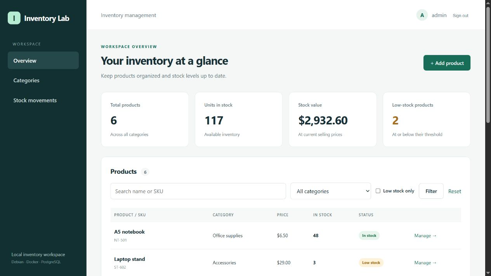
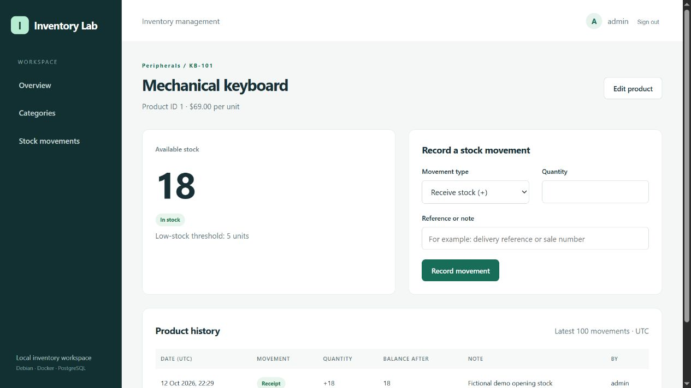
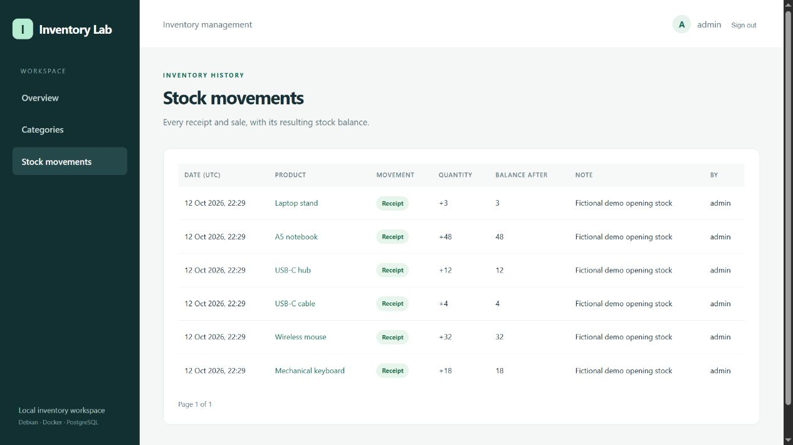
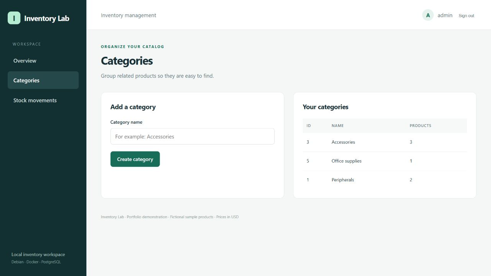
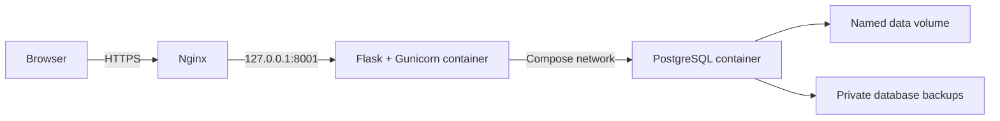

# Inventory Lab

I built this small inventory application to practice deploying a Python service
on Debian with Docker Compose, PostgreSQL and Nginx.

Users can organize products into categories, record incoming stock and sales,
and review the resulting stock history. Products have a unique SKU, a selling
price in USD and a low-stock threshold. Demo products are fictional.



### App screenshots

These screenshots use fictional products from my local lab.







## Architecture



PostgreSQL has no published host port. The app listens on Debian loopback;
Nginx handles browser access. Local HTTPS uses a private lab CA, not a publicly
trusted certificate. The local hostname is `inventory.lab.test`.

## Features

- Login with hashed passwords, CSRF protection and limited failed login attempts.
- Categories, products, search and low-stock filtering.
- Receipts and sales with timestamp, user, quantity and resulting balance.
- Atomic stock updates that prevent concurrent sales from overselling.
- A unique submission identifier to avoid recording the same movement twice.
- Health checks, persistent storage, log rotation and backup scripts.

Stock changes when a user records a movement. There is no connection to an
external shop or payment system. Stock value uses selling prices; it is not an
accounting valuation. One administrator role is implemented. Multi-tenant
access, purchasing, refunds, barcode scanning and payment processing are out of scope.

## Run on a Linux Docker host

Prerequisites: Docker Engine and Docker Compose, Python 3 for secret generation.

```bash
python3 scripts/init-secrets.py
docker compose config --quiet
docker compose up -d db --wait
docker compose build app maintenance
docker compose run --rm maintenance python manage.py init
docker compose run --rm maintenance python manage.py seed
docker compose run --rm maintenance python manage.py runtime-role
docker compose up -d --wait
curl --fail http://127.0.0.1:8001/health
```

Use `sudo docker ...` if your account cannot access Docker. The initialization
script is designed for UID 1000, matching this lab's container user. If the host
user has another UID, adjust container ownership or secret file access explicitly.
Do not make passwords world-readable to work around a UID mismatch.

The initial username is `admin`. Its generated password is in
`.secrets/admin_password`; read that private file locally. Secret files are
excluded from Git and the image build context. Do not include them in screenshots.

For a fresh machine, run the loopback HTTP checkpoint first. Configure Nginx
and a certificate for your hostname, then set `COOKIE_SECURE=true` in `.env`
and recreate the app. A secure session cookie requires an HTTPS browser session.
See [the command guide](docs/COMMANDS.md) and [operations](docs/OPERATIONS.md).

## Verification

```bash
docker compose exec -T app python tests/integration.py
```

The integration script runs against real PostgreSQL and creates isolated test
records, then removes them. It checks forms, CSRF, login, validation, stock math,
duplicate requests and concurrent sales. Use a lab or dedicated test environment.

Restore and container-recreation comparisons are saved under `docs/evidence/`.
The current verified state and limitations are recorded in [VERIFICATION.md](VERIFICATION.md).

## Repository contents

| Path | Purpose |
| --- | --- |
| `app.py`, `templates/`, `static/` | Application and user interface |
| `schema.sql`, `manage.py` | Schema version 1 and sample-data initialization |
| `Dockerfile`, `compose.yaml` | Container packaging, networking and persistence |
| `scripts/` | Secret generation and database backups |
| `tests/` | Integration and data fingerprint checks |
| `configs/` | Example Nginx configuration, with no keys |
| `docs/` | Command explanations, operations and evidence |

Future schema changes need explicit versioned migrations; `init` only establishes
version 1. A Docker volume is not a backup, and a backup kept on the same VM does
not protect against loss of that VM. The checks here are a scoped source and deployment review, not a penetration test or production load test.

## Security maintenance

The web container uses a separate database role with data permissions only. Database administrator credentials and the application admin password are mounted only in the temporary `maintenance` service. Run `sudo python3 scripts/rotate-secrets.py` to rotate the application administrator password and session key. It rebuilds the image, preserves file ownership, checks both old and new credentials, revokes existing sessions, and attempts rollback on failure. This does not change the Debian login password.

Pinned Python versions are installed from `requirements.lock.txt`. Re-audit and update dependencies regularly; a clean advisory check is not a guarantee against unknown vulnerabilities.

